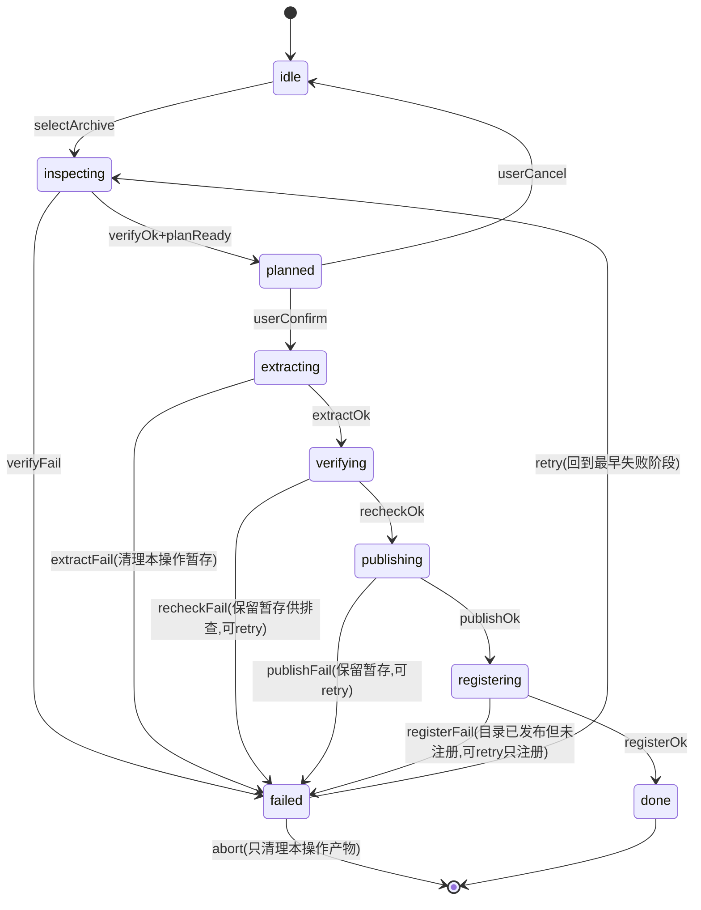
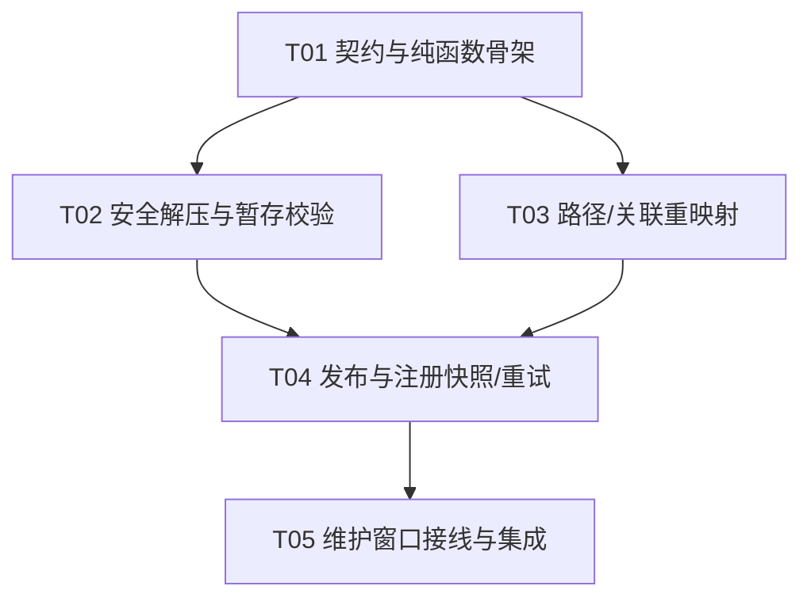

# I6 批次 3 · 新空间恢复 架构设计（只读设计稿）

> 范围来源：`docs/INTEGRATION-PLAN-I6.md` 第 19 行「**3. 新空间恢复：安全解压、路径/快照/偏好关联、目录发布和注册快照/重试。**」
> 与派单描述逐字一致，已核对无偏离。
>
> 上游裁决：`docs/DECISIONS.md` **D-071**（第 848 行 Ruling）与「固定边界」§10–§13；
> `verification-integration-i6-context-control-20261010.md` 两条 Ruling（`ok:false` 一律阻断控制、
> 控制不得嵌套在自身被跟踪处理器内）。
>
> 本文件是**设计稿**，不改动任何源码、不提交、不碰 git、零新增依赖。
> 目标仓库：`example_demo/Mimir-Desktop`（自有 fork `littleworld215/Mimir-Desktop`；**不触碰上游 `hxhy00/Mimir-Desktop`**）。
> 当前基线：分支 `main`，HEAD `b849717`（批次 2 收口）。

---

## 0. 设计前提与既有资产复用

批次 3 是「把已验证的备份归档**解出来并落地成一个全新科研空间**」，全程**只增不覆盖**。
可直接复用的批次 1/2 既有原语（均已存在且有单测）：

| 既有原语 | 文件 | 批次 3 用途 |
|---|---|---|
| `verifyBackup()` / `VerifyError` / `VerifyResult` | `electron/workspaceBackup/verify.ts` | 解压前的**独立验包**（不依赖打包期内存） |
| `assertArchivePathWithinRoot(entryPath, root)` | `electron/workspaceBackup/verify.ts` | 每个条目落地前的 **zip-slip 逃逸**校验（注释已写明「供恢复批次复用」） |
| `validateArchivePaths()` | `electron/workspaceBackup/archivePaths.ts` | Windows 保留名/大小写冲突/文件目录冲突校验 |
| `MANIFEST_IN_ARCHIVE` / `BACKUP_FORMAT_VERSION` / `ArchiveManifest` | `electron/workspaceBackup/packer.ts` | 读取归档内清单、判格式版本 |
| `ManifestEntry` | `electron/workspaceBackup/manifest.ts` | 逐文件 size/sha256 比对基准 |
| `WorkspaceWriterSession` | `electron/workspaceBackup/writerSession.ts` | 恢复期间持有 **registry 锁 + 新空间锁**；事务式提交/回滚 |
| `acquireWorkspaceLock` / `acquireWriterLockFile` | `electron/workspaceBackup/operationGate.ts` | 共同写锁；不猜测残锁 PID/年龄 |
| `WorkspaceOperationGate.runControl` / `drain` | `electron/workspaceBackup/operationGate.ts` | 串行控制 + 排空；`ok:false` 保持阻断 |
| `readRegistryOverview` | `electron/workspaceBackup/registryView.ts` | **只读**浏览注册表（不迁移/不写指针） |
| `writeJsonAtomic`（经 `store.ts`） | `electron/library/store.ts` | 注册表原子写（temp + rename，凭据 0600） |
| `assertWindowsLocalDisk` | `electron/workspaceBackup/localDisk.ts` | 新根/暂存根的本机磁盘校验 |
| `assertSpaceUnchanged` / `currentSpaceEpoch` | `electron/library/store.ts` | 落点/注册阶段防跨空间污染 |

**新增代码原则**：只新增「解压落地 / 关联重映射 / 目录发布 / 注册写入」四类，其余尽量复用上表原语。

---

## 1. 恢复流程的完整状态机（含失败语义）

### 1.1 状态与事件

`RestoreStage` 共 **9 态**（8 个推进态 + `failed` 终态；`done` 亦为终态）：

```
状态（RestorePhase）：
  idle            — 未开始；维护窗口已打开但未选归档
  inspecting      — 只读探测+验包（不落盘）
  planned         — 已产出恢复计划（目标目录、条目数、重映射表、被排除项、空间名），等待用户确认
  extracting      — 解压到同盘暂存根（<targetParent>/.mimir-restore-staging-<uuid>/）
  verifying       — 对暂存内容做二次校验（JSON / 数据库 / 外键 / 文件摘要）
  publishing      — 原子发布暂存根 → 目标新目录（rename）
  registering     — 本机保护注册表原始快照 → 原子追加新 UUID 记录
  done            — 恢复为一个新空间；原空间未动
  failed          — 任一阶段失败后的**终态**；保留可重试资料与产物
```

事件：`selectArchive` / `verifyOk` / `verifyFail` / `planReady` / `userConfirm` / `userCancel` /
`extractOk` / `extractFail` / `recheckOk` / `recheckFail` / `publishOk` / `publishFail` /
`registerOk` / `registerFail` / `retry` / `abort`。

### 1.2 状态转移（Mermaid）



### 1.3 失败语义（**本批最重要**）

| 失败点 | 语义 | 落盘副作用 | 可重试性 | 用户可见 |
|---|---|---|---|---|
| `inspecting` 验包失败（`OPEN_FAILED`/`DIGEST_MISMATCH`/`PATH_ESCAPE`…） | **零副作用**：只读，不建目录 | 无 | 换归档重试 | 明文错误码 + 中文说明 |
| `extracting` 失败（磁盘满 / IO 错 / 条目超限） | 删除**本次**暂存根；不动原空间、不动目标 | 仅本操作暂存被清理 | 释放空间后 `retry` | 报告已清理 |
| `verifying` 二次校验失败（JSON 非法 / 外键不成立 / 摘要不符） | **保留暂存根**供排查，不清目标 | 暂存根保留 | `retry` 可复用暂存或重解 | 报告保留路径 |
| `publishing` 失败（rename 失败 / 目标已存在） | 保留暂存根；目标未创建（rename 前不建目标） | 暂存根保留 | `retry` | 报告保留路径 |
| `registering` 失败（锁清理失败 / 写注册表失败） | **目录已发布且完整**，只有注册未完成 | 新目录保留、暂存已消费 | `retry` **只重做注册**，不重新解压 | 明确「目录已生成，仅需重试注册」 |

**核心纪律（对齐 D-071）：**

1. **失败不授予「半成品空间」**：任何阶段失败，注册表**绝不**出现指向未验证目录的记录。
2. **`failed` 是终态但非破坏态**：`abort` 只清理「本操作产物」（本次暂存根 + 本次已发布但未注册的新目录，且仅当它确由本操作创建）；**绝不**触碰原空间、原注册表、其它空间。
3. **`ok:false` 一律阻断**：注册阶段任何 IPC 返回 `ok:false`（含参数错误）都按失败处理并**保持入口阻断**，由用户显式重试；不把结果对象当成功（对齐 context-control Ruling）。
4. **控制不可嵌套**：恢复必须在外层 `gate.runControl(timeoutMs, fn)` 中执行，内部**不得**再调用 `workspaces:*` 这类自身会被 `installWorkspaceIpcGate` 包进 `runControl` 的通道（否则自我等待排空而死锁）。注册写入走**直接受锁的 store 函数**，不经 IPC。
5. **超时即阻断**：`runControl` 超时 → `controlBlocked = true`，入口保持阻断，`resume()` 抛错，不得用普通退出继续策略延续。

---

## 2. 不可覆盖的落点（non-overwrite landing）

### 2.1 落点规则

- **目标目录**：由用户在**已存在**的本机磁盘父目录下命名，形如 `<parent>/<空间名>`。
  - `parent` 必须通过 `assertWindowsLocalDisk`（原生卷探针，driveType ∈ {2,3}）。
  - 目标目录**必须不存在**；若已存在 → `TARGET_EXISTS`（**拒绝覆盖**，不提供「合并/清空」选项）。
  - 「自动去重」**不复用** `deriveUniquePath`（那个语义是给新建空间默认命名的）；恢复必须**显式**要求用户确认最终落点，避免静默改名造成用户找不到目录。
- **暂存根**：`<parent>/.mimir-restore-staging-<uuid>` —— **与目标同盘**（保证 `publish` 阶段是原子 `rename`，不跨卷）。
  - 暂存根加入排除语义：其目录名以 `.` 开头且不进入任何清单；发布后即被 `rename` 消费掉，天然不残留。
- **绝不原地覆盖**：
  - 原空间根目录在本批次**全程只读**（恢复对象是归档，不是原空间）。
  - 恢复产物永远是**新 UUID + 新目录**；注册表只追加，不替换 `workspaces:list`。

### 2.2 发布（publish）的原子性

- 发布 = 对**同盘**暂存根执行一次 `renameSync(stagingRoot, targetRoot)`。
  - `rename` 前再次 `existsSync(targetRoot)` 复核，仍存在则 `TARGET_EXISTS` 中止并保留暂存。
  - 跨卷会被系统拒绝 → 归入 `publishFail`，保留暂存供用户改到同盘重试。
- 发布后**不删除**暂存（它已被 rename 消费；若 rename 部分失败则保留原暂存排查）。

### 2.3 覆盖防护的三层

| 层 | 手段 | 拦截对象 |
|---|---|---|
| 路径层 | `assertArchivePathWithinRoot` + `validateArchivePaths` | zip-slip、保留名、大小写/文件目录冲突 |
| 落点层 | `TARGET_EXISTS`（rename 前双检） | 覆盖既有目录 |
| 注册层 | 只追加 UUID、保留原 `settings`/`active`/`default` | 覆盖既有空间登记与指针 |

---

## 3. 路径与关联的重映射表（已按实测核实改写）

> **本节已由「推断」升级为「实测核实」。** 核实结论：原本设想的多数「重映射项」**并不存在或不可行**，
> 真正需要改写的**只有一处**（`PaperRecord.pdfPath`）。因此本节按 team-lead 的 U1 结论重写，
> 并把 T03 从「重映射」缩为「**关联路径审计**」。

### 3.0 实测核实结果（含字段名与行号）

| 候选 | 实测结论 | 证据（文件:行） |
|---|---|---|
| 论文快照桶 slug | **与空间路径无关**：`slugOfProjectDir(projectDir) = sha1(projectDir).slice(0,16)`，`rootOf` 里 slug 只由 `projectDir` 决定，`spaceRoot()` 只决定父目录 | `electron/paper/snapshots.ts:32-34, 43`；桶内 `PaperSnapshotMeta.files[].path` 是**相对 projectDir** 的路径（`:145` `relative(base, file)`），**不嵌绝对路径** |
| 由快照桶 slug 推出「需重映射」 | **不成立**。新空间里恢复出的桶名仍是 `sha1(旧projectDir)`；只要用户仍用同一 `projectDir`，`rootOf` 算出的 slug 不变，**能命中原桶**。仅当用户**自行改变 projectDir** 才失配——那是「用户目录迁移」问题，**批次 3 不处理** | 同上 |
| 任务包空间 ID | **无需重映射**：`workspaceId`/`spaceEpoch` 是**运行期参数**，不是持久化字段；恢复后由新注册表 UUID 自然给出 | `electron/assets/store.ts:110-122` |
| `assets.db` → `asset_version.file_path` | **不改写**：存的是**相对**资产库根路径（`files/<assetId>/<blob>-<name>`），天然可迁移；且 `asset_version` 有 **append-only 触发器**禁止 UPDATE | `electron/assets/schema.ts:98-110, 130-136` |
| `assets.db` → `asset.external_url` | **不改写**：外链不属空间内路径 | `electron/assets/schema.ts:75-95` |
| `figures:list`（`FigureRecord`） | **不改写**：只存 `fileName`（basename）；`figuresDir()` 每次由 `spaceRoot()` 现算 | `electron/figures/figuresService.ts:16-23`（`FigureRecord`）、`:26-28`（`figuresDir()`）、`:43-49`（读写） |
| `meetings:index` | **不改写**：只存 `{title, slides, createdAt}`，无路径 | `electron/meetings/service.ts:106, 255` |
| `ledger:entries` | **不改写**：无路径字段 | `electron/ledger/ledgerService.ts:20-30` |
| `ProjectRecord.paperDir` | **绝不改写**：是用户在**空间之外**自选的 LaTeX 目录，非空间内路径 | `electron/library/types.ts:71-80`；`electron/ipc/library.ts:81-83` |
| 项目产物目录 `projects/<id>` | **不改写**：`join(spaceRoot(), 'projects', project.id)` 在**使用点现算**，非持久化 | `electron/library/libraryService.ts:366-368, 582-584` |
| **`PaperRecord.pdfPath`** | ✅ **唯一真正需要改写的字段**：持久化的**绝对路径** `join(spaceRoot(), 'papers', <file>)`，指向**旧空间**目录；恢复后必须改为新空间根 | `electron/library/types.ts:62-63`；`electron/library/libraryService.ts:60-61, 273, 283` |

### 3.1 白名单（**仅此一处**改写）

| # | 载体 | 字段 | 旧值形态 | 新值 |
|---|---|---|---|---|
| **R1** | 空间层 `library:papers` → `PaperRecord.pdfPath` | 绝对路径 | `<旧空间根>/papers/<file>` | `<新空间根>/papers/<file>` |

改写规则（**严格**）：
- **仅当** `pdfPath` 是**以旧空间根为前缀的绝对路径**时才替换为「新空间根 + 剩余相对部分」；
- 不是旧空间根前缀的值（例如用户手工指向了空间外的 PDF）**原样保留**，计入「未重映射」告警计数，**不失败**；
- **不做**任何自由文本的全局 search-replace（D-071 明文）。

### 3.2 明确不改写（历史自由文本与既有结构一律保留）

- 资产正文 `asset_version.content`、`asset.description`、`asset.notes`、`tag.name`、分类名/描述、`ai_draft.content`、`ai_draft.prompt_snapshot`、`saved_filter.name` 等**任何用户语义内容**。
- `asset_version.file_path`（相对）、`asset.external_url`、`figures:list`、`meetings:index`、`ledger:entries`、`ProjectRecord.paperDir`、`projects/<id>`（现算）。
- **不重建** `asset_version` 表：它有 **append-only 触发器**（`electron/assets/schema.ts:130-136`），是 D-021「结构只增不删」+ 版本不可变的**刻意护栏**；为一次恢复去重建表 = 绕过不可变护栏，风险远大于收益。且 `file_path` 是相对路径，**本就不需要改写**。→ **批次 3 不做表重建**（记录此理由，防后人误以为遗漏）。

### 3.3 偏好（preference）关联

- **全局层偏好不迁移也不改写**：`settings`、`servers:list` 是跨空间共享的全局键（`store.ts` `GLOBAL_KEYS`），**不进备份、不参与恢复**（对齐固定边界「全局账户/模型/服务器凭据不打包」）。
- **空间层偏好**：随空间层 `store.json` 一并恢复；其中**已验证**无内嵌旧绝对路径（见 §3.0）——若审计时**确实发现**（见 §3.5 审计步骤）则按 R1 同规则改写。
- **`active` / `default` 指针**：恢复**绝不**改动——新空间是**追加注册**，不自动激活。

### 3.4 改写执行点

改写对**暂存副本**执行（不触碰归档原件、不触碰原空间），在 `verifying` 阶段内：

1. 解压阶段：仅按归档原样落盘到暂存根。
2. `verifying` 阶段内：
   a. 读取暂存根的**空间层 `store.json`**（`library:papers`）与（只读）`assets.db`；
   b. 对空间层 `store.json` 中**白名单字段** `library:papers[].pdfPath` 执行 R1 改写（纯 JSON 键值改写，**不触碰任何 SQLite 表**）；
   c. 改写后重新校验 JSON 可解析、`assets.db` 的 `PRAGMA integrity_check` 与外键。
3. 任何一步失败 → `recheckFail`，保留暂存根，**不发布**。

> R1 的实际载体是**空间层 `store.json` 的 `library:papers` 表**（属 JSON，不在 SQLite），因此改写是**纯 JSON 键值改写**，**不触碰任何 SQLite 表**——这同时**彻底避开了 `asset_version` append-only 问题**。

### 3.5 T03 实际范围 = **关联路径审计（audit）**

T03 不做「主动重映射一切」，而是：

1. **只读扫描**归档内恢复出的空间层配置，**枚举实际发现的绝对路径引用**（重点是 `library:papers[].pdfPath`），产出：
   - `found[]`：发现的旧空间根前缀引用（字段路径 + 旧值）；
   - `rewritten[]`：已按 R1 改写为新根的值；
   - `skipped[]`：非旧根前缀、原样保留的值（附原因）。
2. **白名单式改写**：只改 §3.1 的结构化字段；**自由文本一律不动**。
3. **明确不做**：不改快照桶 slug、不改任务包（无需）、不重建 `asset_version` 表。
4. **验收标准**：「**扫描结果如实反映真实引用，无遗漏也无误改**」。**允许结论是「零处需重写」——不算失败。**

> 若审计在真实合成归档中发现 §3.0 之外的**新**绝对路径字段，须**先摘字段名+行号回传 team-lead 复核**，再决定是否扩回重映射；不擅自扩大改写面。

---

## 4. 注册表操作的安全边界

### 4.1 写入流程（严格顺序）

```
① 校验 home 锁：session.assertRegistryHome(homedir())
② 只读读取当前注册表：readRegistryOverview(homedir())  （不 loadStore！）
③ 本机保护快照：把 ~/.mimir/store.json 原字节复制为
   ~/.mimir/store.json.pre-restore-<ISO时间戳>.bak （不使用会被 prune 匹配的命名）
④ 构造新记录 { id: randomUUID(), name, path: 新目录, createdAt, updatedAt }
⑤ 原子追加：经 store 的 writeJsonAtomic 写回 ~/.mimir/store.json
   保留 settings / servers:list / activeWorkspaceId / defaultWorkspaceId 原值，
   仅 workspaces:list 追加一条
⑥ 复核：重新 readRegistryOverview 确认新记录存在
```

### 4.2 安全边界（**逐条**）

| # | 边界 | 规则 |
|---|---|---|
| S1 | **只追加** | 仅向 `workspaces:list` 追加；不修改既有条目、不删除、不改 `active`/`default` |
| S2 | **不 loadStore** | 注册阶段**禁止**调用 `loadStore()`（它会自动迁移、创建默认空间、写全局指针——见 `registryView.ts` 注释）；只用 `readRegistryOverview` 读 |
| S3 | **本机保护快照** | 写前必须复制原 `store.json` 字节；快照命名**故意**不匹配保留策略 prune 模式（prune 不得清理它） |
| S4 | **原子写** | 必须经 `writeJsonAtomic`（temp + rename；凭据键名命中则 0600），禁止直接 `writeFileSync` 覆盖 |
| S5 | **锁先行** | 写注册表前必须已持 `registry.writer-lock`（`WorkspaceWriterSession.registry`）；写新空间目录前必须已持该目录 `workspace.writer-lock` |
| S6 | **不猜残锁** | 遇到已存在锁 → 报错阻断；**绝不**按 PID/时间戳判定残锁可删 |
| S7 | **路径只由主进程生成** | 新空间路径不接受渲染层传入的任意字符串拼接；由主进程规范化 + `assertWindowsLocalDisk` + canonical 校验 |
| S8 | **链接拒绝** | `.mimir` 控制目录、`assets` 目录不得为符号链接/junction（`lstatSync` + `realpathSync` 双检） |
| S9 | **失败可重试** | `registerFail` 保留已发布目录；`retry` **只重做注册**，不重新解压（幂等：以新 UUID 追加，故重试需**先检查**是否已写入成功，避免重复记录） |
| S10 | **崩溃只清本操作产物** | 崩溃恢复时只清理「本操作」的暂存根与未注册的新目录；识别依据是操作 token 落盘于暂存根内 |

### 4.3 ⚠️ **本沙箱不可验证的环节（明确标注）**

以下步骤**无法在当前环境（CodeBuddy sandbox / Git Bash）验证**，必须标注在实现与验收中，交由**真实 Windows x64 本机**验收：

| 环节 | 为何不可验证 |
|---|---|
| **本机磁盘卷探针** `assertWindowsLocalDisk` | 依赖 `powershell.exe + Add-Type + GetVolumePathNameW/GetDriveTypeW`；沙箱**禁止 PowerShell / Add-Type** → 恒抛 `NATIVE_PROBE_UNAVAILABLE`。`test/unit/workspaceBackup/localDisk.test.ts` 在沙箱**必然失败**（已知既有限制） |
| **注册表真实写入 `~/.mimir/store.json`** | 沙箱不应写真实 HOME；只能以 `mkdtemp` 合成 home 测 `readRegistryOverview` / 快照 / 原子写的**纯函数**部分 |
| **真实 Windows junction 拒绝** | `isSymbolicLink()` 在 Windows 对 junction 返 true，但真实 junction 的**创建与拒绝**需真实文件系统权限；DECISIONS 记录该回归**仍延期** |
| **跨卷 rename 拒绝** | 需要两个不同卷；沙箱只有单一盘 |
| **真实 Electron 维护窗口端到端** | 需要真实 `Mimir.exe` + 维护入口 `--workspace-maintenance`；沙箱只跑 vitest（`electron` 走 stub） |
| **原生 `better-sqlite3` 在真实 Electron ABI 下打开恢复库** | vitest 用 node ABI binding；打包 ABI 需真实 Electron |

**结论**：批次 3 的**纯逻辑层**（状态机、R1 单字段审计/改写、注册追加纯函数、路径校验）**可在沙箱用 vitest 全覆盖**；
**磁盘/注册表/Electron/跨卷/卷探针**必须留档为「真实 Windows 验收项」，不得用沙箱绿冒充。

---

## 5. 任务分解（依赖排序）

> 硬约束：≤5 个任务；每任务 ≥3 个相关文件；T01 为项目基础设施（本批新增文件 + 契约 + 挂载）。
> 说明：本批**零新增运行时依赖**，故 T01 不含依赖声明改动。

| Task | 名称 | 源文件（新增/修改） | 依赖 | 优先级 |
|---|---|---|---|---|
| **T01** | 恢复契约与纯函数骨架（基础设施） | `shared/workspaceRestoreContracts.ts`（新增：`WORKSPACE_RESTORE_CHANNELS`、`RestorePhase`、`RestorePlan`、`RestoreOutcome` 契约）、`electron/workspaceBackup/restorePlan.ts`（新增：`planRestore(archivePath, limits)` → 验包 + 生成计划 + 重映射预览）、`electron/workspaceBackup/restoreState.ts`（新增：纯状态机 `RestoreMachine` + 转移表） | — | P0 |
| **T02** | 安全解压与暂存校验（数据层） | `electron/workspaceBackup/extract.ts`（新增：`extractToStaging()`；逐条 `assertArchivePathWithinRoot` + `validateArchivePaths`，store 优先、拒绝越界/链接）、`electron/workspaceBackup/recheck.ts`（新增：暂存 JSON/数据库/外键/摘要二次校验）、`electron/workspaceBackup/stagingRoot.ts`（新增：同盘暂存根命名 + 排除语义 + token 落盘） | T01 | P0 |
| **T03** | **关联路径审计**（原「重映射」，已按 U1 缩范围） | `electron/workspaceBackup/remapAudit.ts`（新增：只读扫描空间层配置，产出 `found[]/rewritten[]/skipped[]`）、`electron/workspaceBackup/remapRules.ts`（新增：**单字段**白名单常量 `pdfPath` + 旧根前缀匹配器，纯函数）、`electron/workspaceBackup/spaceStoreRemap.ts`（新增：空间层 `store.json` 键值改写，纯函数；只改白名单字段） | T01 | P0 |
| **T04** | 目录发布与注册快照/重试 | `electron/workspaceBackup/publish.ts`（新增：同盘 `rename` 发布 + `TARGET_EXISTS` 双检）、`electron/workspaceBackup/registryAppend.ts`（新增：S1–S10 注册追加 + 本机保护快照 + 幂等重试）、`electron/workspaceBackup/restoreRunner.ts`（新增：把 T01–T04 串成 `runControl` 内的一次恢复编排，失败语义见 §1.3） | T01,T02,T03 | P0 |
| **T05** | 维护窗口接线与集成 | `electron/workspaceBackup/maintenanceMain.ts`（修改：新增 `workspaceBackup:restore*` handler，保持沙箱桥最小与 `setWindowOpenHandler` deny）、`electron/workspaceBackup/ipcGate.ts`（修改：把恢复相关 control 通道纳入既有集合语义，**不**新增自身等待）、`shared/workspaceBackupContracts.ts`（修改：`MaintenanceOverview` 扩展恢复进度字段，向后兼容）、`test/unit/workspaceBackup/restore*.test.ts`（新增，见 §6） | T01–T04 | P0 |

**依赖图**



---

## 6. 测试挂载点

全部挂载在**既有** `test/unit/workspaceBackup/` 目录，沿用 `vitest.config.ts`（`environment: node`、`include: test/**/*.test.ts`）。
**注意**：`vitest.config.ts` 已把 `electron/library/store.ts` 重定向到 `test/stubs/store.ts`（`isolated-library-store` 插件 + alias）。
批次 3 若需要**真实** store 行为（如 `writeJsonAtomic`），须在**独立测试文件**内用 `/* @vite-ignore */` 动态 `import()` 真实路径（沿用 `registryView.test.ts` 的 `subject()` 手法），**不能**依赖静态 import——否则拿到的是 stub。

| 挂载文件（新增） | 覆盖内容 | 反假绿要求 |
|---|---|---|
| `test/unit/workspaceBackup/restoreState.test.ts` | §1 状态机全部合法/非法转移、终态不可再转移 | 每个 `failed` 分支至少一条「副作用断言」 |
| `test/unit/workspaceBackup/restorePlan.test.ts` | 验包 → 计划；`PATH_ESCAPE`/`DIGEST_MISMATCH` 归类 | **失败组必须有**：损坏归档 → 计划拒绝 |
| `test/unit/workspaceBackup/extract.test.ts` | zip-slip 拒绝、保留名拒绝、store 解压、目录条目 | 构造真实 ZIP（`yazl`）含 `../` 与其变体 |
| `test/unit/workspaceBackup/recheck.test.ts` | 外键/JSON/摘要二次校验；`asset_version` 触发器 | **双组**：通过组 + 篡改组 |
| `test/unit/workspaceBackup/remapAudit.test.ts` | §3 审计：枚举 `library:papers[].pdfPath`；R1 改写；**正文/描述/标签不被改写**；`skipped[]` 记录非前缀值 | **必须含「自由文本未被全局替换」断言**（对齐 D-071）+「零处需重写也不失败」用例 |
| `test/unit/workspaceBackup/remapRules.test.ts` | 白名单常量只含 `pdfPath`；旧根前缀匹配器边界（大小写/尾分隔符/空间外路径不改） | 失败组：空间外绝对路径 → `skipped` 而非改写 |
| `test/unit/workspaceBackup/publish.test.ts` | `TARGET_EXISTS` 拒绝；同盘 rename 成功 | 失败组：目标已存在 → 不改动既有目录 |
| `test/unit/workspaceBackup/registryAppend.test.ts` | S1–S4/S9：只追加、快照命名、幂等重试、原指针保留 | **双组**：写成功 / 写失败（模拟 rename 失败）；断言 `settings`/`active`/`default` 逐字不变 |
| `test/unit/workspaceBackup/restoreRunner.test.ts` | §1.3 六类失败点的落盘副作用 | 每类失败都要断言「原空间未动 + 注册表无新记录」 |

**沙箱内必然失败/跳过的**（须在测试内 `it.skip` 或环境门控，并在验收留档标注）：
`localDisk.test.ts` 全程、任何真实 `~/.mimir` 写入、真实 junction、跨卷 rename、真实 Electron 窗口。

---

## 7. 风险表

| # | 风险 | 等级 | 触发条件 | 缓解 |
|---|---|---|---|---|
| K1 | **重映射误伤正文**（把用户文本里的旧路径字符串全局替换） | **高** | 实现走了「全文 search-replace」而非白名单 | §3.1 单字段白名单 + `remapAudit.test.ts` 强制「自由文本未变」断言 |
| K2 | **遗漏未发现的旧绝对路径字段** | 中 | §3.0 之外还有持久化绝对路径 | T03 **审计**枚举 `found[]/skipped[]`；发现新字段先摘行号回传复核（U6） |
| K3 | **注册表写入违反「不 loadStore」** → 触发自动迁移/建默认空间 | **高** | 误用 `loadStore()` | S2 硬规则 + code review 检查点 + 单测断言「未创建 `.mimir/store.json` 以外的默认空间」 |
| K4 | **越界解压（zip-slip）** | **高** | 未逐条调用 `assertArchivePathWithinRoot` | 解压前对**每条**路径调用；`extract.test.ts` 构造恶意 ZIP |
| K5 | **覆盖既有空间** | **高** | `TARGET_EXISTS` 未双检 / rename 落到已存在目录 | §2.3 三层防护 + `publish.test.ts` 失败组 |
| K6 | **控制嵌套死锁** | 中 | 恢复内部再调 `workspaces:*`（被 IPC 闸门包进 `runControl`） | §1.3 规则 4；注册走直接函数不经 IPC |
| K7 | **`ok:false` 被当成功** | 中 | 注册失败返回 `{ok:false}` 却继续 | §1.3 规则 3：`ControlResultFailure` 语义 + 单测失败组 |
| K8 | **残锁误删** | 中 | 实现按 PID/时间猜残锁 | S6 + 复用 `acquireWriterLockFile` 的 token 复核 |
| K9 | **跨卷 rename 失败** | 中 | 暂存与目标不同盘 | §2.1 强制同盘暂存；失败归 `publishFail` 保留暂存 |
| K10 | **摘要假阳性** | 中 | 恢复后按**磁盘实时**库校验，而归档内是快照 | 校验基准取**归档内清单**（对齐 digest-follows-archive 规则） |
| K11 | **沙箱绿冒充真实绿** | 中 | 用 vitest 通过宣称恢复可用 | §4.3 不可验证清单 + 验收留档「真实 Windows 项」 |
| K12 | **崩溃残留暂存/未注册目录** | 低 | 进程崩溃在中途 | §4.2 S10：token 落盘暂存根，崩溃恢复只清单操作产物 |
| K13 | **`.mimir` 目录为链接** | 低 | 攻击者/误配置 | S8 双检 `lstatSync` + `realpathSync` |

---

## 8. 未决项与假设（U1/U2 已由 team-lead 实测结论收口）

| # | 事项 | 结论 |
|---|---|---|
| U1 | 论文快照桶 / 任务包空间 ID 是否需重映射 | **已核实：不需要**。快照桶 slug 只由 `projectDir` 决定（与空间路径无关）；任务包空间 ID 是运行期参数非持久字段。T03 已删去这两项。 |
| U1b | `PaperRecord.pdfPath` | **已实测确认是唯一需改写项**（持久化绝对路径含旧空间根）；T03 据此保留 R1。 |
| U2 | 是否需要 `asset_version` 表重建 | **已批准不做**。append-only 触发器是刻意不可变护栏；`file_path` 是相对路径本就不需改。设计已记录「为何不做」。 |
| U3 | `.mimir-restore-staging-<uuid>` 是否需 `.gitignore` | 暂存根位于**用户资料盘**（通常非仓库），无需；若落在仓库内则需加。 |
| U4 | 恢复进度回调传输方式 | 假设沿用维护窗口 IPC；避免新增依赖。 |
| U5 | 真实卷探针在 CI 的行为 | 假设 CI 为 Linux/无 PowerShell → `localDisk` 相关测试须门控跳过。 |
| U6 | §3.0 之外是否还有未发现的旧绝对路径字段 | **开放**：须由 T03 的**审计**在真实合成归档中确认；若发现**先摘字段名+行号回传 team-lead 复核**，不擅自扩大改写面。 |
