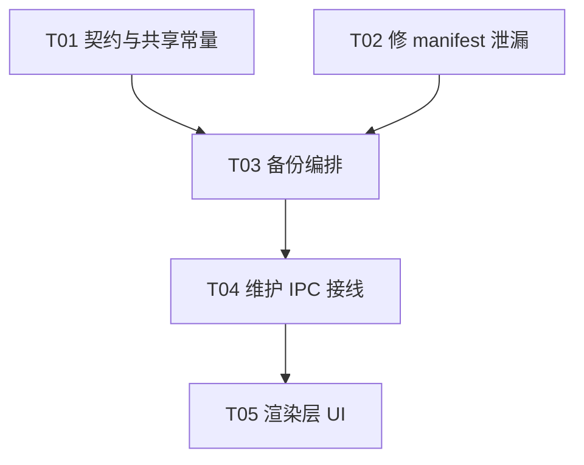

# I6 批次 3.5 · 备份生产接线收口（逐空间备份 + 只读快照 + 归档落地 backups/）架构设计

> 缺口来源：批次 2 已实现 `createBackup`（打包原语）与批次 5 已实现归档命名规范与保留策略，
> 但**生产代码中 `createBackup` 没有任何调用点**——归档既不会被生产、也不会落进 `backups/`，
> 导致批次 5 的保留策略在真实运行中**找不到归档**，批次 6 的「打包闭环验证」**无对象可验**。
> 本批补齐这条链路；不新增功能面、不改既有语义。
>
> 上游裁决：`docs/DECISIONS.md` **D-012**（store-only ZIP、两遍读法）、**D-032**（保留策略）、
> I6 固定边界「流式ZIP64…源SQLite一致快照，不迁移源库；源外暂存、验包后不可覆盖发布」、
> 批次 3 §4.2 **S1–S10**、批次 5 §1.1（归档命名规范）。
>
> **用户裁决（本轮 AskUserQuestion）**：
> ① 入口形态 = **逐空间备份**（维护窗口每个空间一个按钮）；
> ② 库句柄 = **只读打开 `assets.db` 做一致快照**。
>
> 本文件是**设计稿**：不改动任何源码、不提交、不碰 git、零新增依赖。
> 当前基线：分支 `main`，HEAD `5671a97`（批次 5 收口）。

---

## 0. 设计前提：**两个实测结论**（先验证再设计）

### 0.1 ✅ 前提验证一：readonly 源库的 `backup()` 可用

实测（`mkdtemp` + node ABI binding）：
- `delete` 模式库：`readonly:true` 打开 → `backup()` **成功**，快照可读。
- **WAL 模式库**：`readonly:true` 打开 → `backup()` **同样成功**，快照内容正确。

→ **用户裁决「只读打开做快照」技术可行**，无需改为读写打开。

### 0.2 ⚠️ 前提验证二：readonly 打开 WAL 库**会在源目录创建 `-shm` / `-wal`**（**非零副作用**）

实测：`readonly:true` 打开 WAL 库后，源目录出现 `assets.db-shm` + `assets.db-wal`。
（SQLite 需要共享内存文件维护 WAL 索引，即使只读。）

**两个必须处理的后果**：

**(a) 「只读」不是零副作用**——本批的「只读」措辞要精确化为「**不修改源库内容**」，
而非「不触碰源目录」。这些文件在维护模式下可接受（源空间本来就有），但必须**在设计中如实记录**，
不得像批次 3 那样声称「原空间全程只读」而实际留下文件（那是**措辞不诚实**）。

**(b) 🔴 实测挖掘出的真实缺陷**：`manifest.ts:102` 的 `EXCLUDED_PREFIXES` **只有**
`.mimir/assets/staging/`——**未排除 `-wal` / `-shm` / `-journal`**。后果：

> 打包时若扫描到 `assets.db-wal` / `assets.db-shm`，它们会被**照原样打进归档**；
> 而 `assets.db` 本体已被**快照内容替换**（`packer.ts:99-101` 的 `overrides.replacement`）。
> 于是归档里出现「**快照版 `assets.db` + 实时版 `assets.db-wal`**」的**不一致组合**——
> 恢复时 SQLite 可能据此重放一个**与本库无关的 WAL**，构成**潜在损坏**。
> 而 `-wal`/`-shm` 是**瞬态**文件，**本就不该进归档**。

→ **本批必修**：`manifest.ts` 的排除规则增补 `-wal`/`-shm`/`-journal` 后缀（见 §3 T02）。
这条与 `-wal` 无关的另一个保险：**备份期间不打开源库就不会有 `-wal`**——但用户裁决要「只读打开做快照」，
所以**必须**从清单层排除，两条防线都要。

---

## 1. 备份编排（服务层）

### 1.1 编排流程（**顺序严格**）

```ts
export interface BackupSpaceDeps {
  readonly home: string
  readonly now?: () => Date
  /** 只读解析已登记空间（复用批次 4 的 `readRegistrySpacePaths`）。 */
  readonly resolveSpaces?: (home: string) => SpacePathView[]
  /** 打开源库做快照（缺省 readonly 打开；注入以隔离 IO）。 */
  readonly openAssetsDb?: (dbPath: string) => { backup(dest: string): Promise<void>; close(): void }
  readonly createBackup?: typeof createBackup
  readonly onProgress?: (p: { stage: string; detail: string }) => void
}

export interface BackupSpaceRequest {
  /** 目标空间 id（**由主进程从注册表解析根，渲染层只传 id**，对齐 §4.2 S7）。 */
  readonly spaceId: string
}

export async function runSpaceBackup(request: BackupSpaceRequest, deps: BackupSpaceDeps): Promise<BackupOutcome>
```

流程：
```
① 校验入参：spaceId 非空；否则 INVALID_SPACE（不取锁、不建目录）
② 只读解析注册表 → 找到该 spaceId 的 {name, path}
   - 找不到 → SPACE_NOT_FOUND；注册表不可读 → REGISTRY_INVALID
③ 取锁：session.assertUsable()（维护会话已持 registry 锁）；
   + 目标空间目录的 workspace.writer-lock（防与普通模式写者并发）
   —— ⚠️ 详见 §1.2 的锁策略裁决
④ 打开源库做一致快照：readonly 打开 `<space>/assets.db`
   - 库不存在 → 允许（`assetsDb:null`，归档不含库；报告 excluded 提示）
   - 打开失败 → BACKUP_FAILED（不静默降级）
⑤ 生成归档名：deriveArchiveName(space.name, now())（批次 5 规范）
⑥ createBackup({root: space.path, destination: join(backupsDir, name), stagingDir: 源外同盘暂存, assetsDb, assetsDbRelPath})
   —— destination 用「受管命名」故 T03 的 `spaceName` 门控自然通过（或直接给 destination 且符合规范）
⑦ 关库句柄（无论成败）
⑧ 写审计（复用批次 4 auditWriter：action='backup'，**需扩契约联合类型**）
⑨ 返回 Outcome（成功含 entries/totalBytes/archiveBytes/archiveSha256/excluded；失败含 code/detail）
```

### 1.2 ⚠️ 锁策略裁决（**本批最需要谨慎的点**）

**问题**：`createBackup` 读取空间目录全部内容（含 `assets.db`）。若此时普通模式正有写者在改空间，
归档会**撕裂**。批次 3 §4.2 S5 的纪律是「写新空间目录前必须已持该目录 `workspace.writer-lock`」。

**候选**：
- (A) 取**目标空间**的 `workspace.writer-lock`。→ 与普通模式写者互斥。
  但维护模式下**普通模式窗口已关闭**（`handoff.ts` 排空后 relaunch），故实际上**无并发写者**。
- (B) 不额外取锁，仅依赖「维护模式 = 普通窗口已关闭」这一事实。

**裁决**：**取 (A) 但作为「可用性检查」而非「并发防护」**——即：尝试取锁，**若已被持有则拒绝备份并报
`LOCK_UNAVAILABLE`**（绝不按 PID/年龄猜残锁，对齐 S6）。理由：
- 它把「是否有并发写者」变成**可验证的事实**，而不是依赖「维护模式应该没写者」的**假设**；
- 成本极低（一次 `wx` 创建）；
- 与 S5/S6 一致，且**绝不**猜测残锁。
- 若实现者发现维护会话已持目标空间锁（需勘察 `WorkspaceWriterSession.select`），则复用而非重复取。

> **需实现者勘察后定夺**：`writerSession.select(root, maintenance)` 的具体语义（是否已为「当前空间」持锁）。
> 若维护会话**不**为任意空间持锁，则走 (A)；若已有机制，复用。**不得**自造第二套锁。

### 1.3 落点

- 归档最终落 **`join(home, 'backups')`**（与批次 5 的 `listManagedArchives` 默认目录、批次 4 doctor 的
  `archiveDir` 默认值**同一事实源**——建议抽一个共享常量 `ARCHIVE_DIRECTORY_NAME`）。
- `backups/` **不存在时**：`mkdirSync(recursive)`（这是**写路径**，允许建目录；与只读扫描区分）。
- 暂存：**源外同盘**（`packer` 要求），建议 `join(home, 'backups', '.staging')` 或 `dirname(destination)` 下的
  `.mimir-backup-staging-<uuid>`——**必须同盘**（保证原子 rename）。暂存名以 `.` 开头且不被
  `listManagedArchives` 匹配（它只认 `mimir-backup-*.zip`，天然排除 `.staging`）。

---

## 2. 契约与 IPC 扩展（只追加、可选、向后兼容）

### 2.1 通道（`WORKSPACE_BACKUP_CHANNELS` 追加）

```ts
backupSpace:     'workspaceBackup:backupSpace',      // 写，invoke（入参 {spaceId}）
backupProgress:  'workspaceBackup:backupProgress'    // 事件
```
**纪律**：均**不进** `ipcGate.ts` 的 `control`/`workspaceChanges` 集合；由 `maintenanceMain` 独立注册。

### 2.2 类型

```ts
export interface MaintenanceBackupRequest { readonly spaceId: string }   // 只传 id，不传路径（S7）
export type MaintenanceBackupResult =
  | { ok: true; spaceId: string; name: string; archiveName: string; entries: number
      totalBytes: number; archiveBytes: number; excluded: number }
  | { ok: false; code: string; detail: string }
export interface MaintenanceBackupProgress { readonly stage: string; readonly detail: string }
```
- `archiveName` 是 **basename**（**不含绝对路径**）；其余字段无路径。
- 契约追加 `MaintenanceAuditEntry.action` 增 `'backup'`（§3 T01）。

### 2.3 `WorkspaceBackupMaintenanceApi` 追加（全可选）
`backupSpace?(request)` / `onBackupProgress?(listener)`。

---

## 3. 任务分解（依赖排序，≤5 任务）

| Task | 名称 | 源文件（新增/修改） | 依赖 | 优先级 |
|---|---|---|---|---|
| **T01** | 契约与共享常量（基础设施） | `shared/workspaceBackupContracts.ts`（追加 2 通道 + backup 类型；`MaintenanceAuditEntry.action` 增 `'backup'`）、`electron/workspaceBackup/archivePaths.ts` 或新增 `directories.ts`（**共享 `ARCHIVE_DIRECTORY_NAME` 常量**，收口 `maintenanceMain.ts:20` 与 doctor/retention 的默认值）、`test/unit/workspaceBackup/*`（契约断言） | — | P0 |
| **T02** | 🔴 **修 manifest 瞬态文件泄漏**（真实缺陷） | `electron/workspaceBackup/manifest.ts`（`EXCLUDED_PREFIXES` 之外**新增后缀排除** `-wal`/`-shm`/`-journal`；纯函数 + 注释说明 §0.2 的实测依据）、`test/unit/workspaceBackup/manifest.test.ts`（新增「瞬态文件不进清单」用例 + 变异验证） | — | **P0** |
| **T03** | 备份编排服务层 | `electron/workspaceBackup/backupService.ts`（**新增**：`runSpaceBackup` 编排 §1.1；只读开库快照；取锁 §1.2；归档落点 §1.3；审计）、`test/unit/workspaceBackup/backupService.test.ts`（新增，含锁占用拒绝 / 库不存在降级 / 失败清理暂存） | T01,T02 | P0 |
| **T04** | 维护 IPC 接线 | `electron/workspaceBackup/maintenanceBackupHandler.ts`（**新增**，纯注入不 import electron）、`electron/workspaceBackup/maintenanceMain.ts`（注册 + 进度推送）、`electron/workspaceBackup/maintenancePreload.cjs`（追加 2 方法）、`test/unit/workspaceBackup/maintenanceBackupIpc.test.ts`（新增） | T03 | P0 |
| **T05** | 渲染层 UI 与收口 | `src/renderer/maintenance.tsx`（每个空间加「备份该空间」按钮 + 进度 + 结果）、`src/renderer/maintenance.css`、`test/unit/workspaceBackup/maintenanceUiContract.test.ts`（追加断言） | T04 | P0 |

**依赖图**


---

## 4. 测试挂载点

| 挂载文件 | 覆盖 | 反假绿要求 |
|---|---|---|
| `manifest.test.ts`（改，T02） | `assets.db-wal`/`-shm`/`-journal` **不进清单**；正常文件仍进 | **变异验证**：移除后缀排除 → 用例变红 |
| `backupService.test.ts`（新） | 编排全流程；锁占用 → `LOCK_UNAVAILABLE`；库不存在 → 归档成功但 `excluded` 提示；`spaceId` 不存在 → `SPACE_NOT_FOUND`；失败清理暂存 | **双组**：成功组 + 逐项失败组；断言失败后**暂存根被清理、backups/ 无残留** |
| `maintenanceBackupIpc.test.ts`（新） | 规范化 / 非信 sender / 裁剪（无绝对路径）/ 进度 | 断言结果**不含** home 路径 |
| `maintenanceUiContract.test.ts`（改） | 备份按钮 + 进度接线 + 判存在降级 | 字符串断言 |

**沙箱内必然失败/跳过**：`localDisk.test.ts`；真实 `~/.mimir` 写入（一律 `mkdtemp`）；
**真实 Electron ABI 下的 `better-sqlite3`**（vitest 用 node ABI）→ 留真实 Windows 验收。

---

## 5. 风险表

| # | 风险 | 等级 | 缓解 |
|---|---|---|---|
| K1 | **瞬态 `-wal`/`-shm` 进归档 → 恢复潜在损坏** | **高** | T02 清单排除 + 不打开源库则无 `-wal`（两条防线） |
| K2 | **归档撕裂**（备份时有并发写者） | **高** | §1.2 取锁 + 锁占用即拒绝（不猜残锁） |
| K3 | **「只读」措辞不诚实**（实际留 `-shm`/`-wal`） | 中 | §0.2(a) 措辞精确化：「不修改源库内容」而非「不触碰源目录」 |
| K4 | **渲染层指定路径** | 高 | 只传 `spaceId`，主进程解析根（S7） |
| K5 | **归档名不合规范 → 保留策略找不到** | 中 | `deriveArchiveName` + T03 的 destination 门控 |
| K6 | **库打开失败被静默降级为「无库归档」** | 中 | 库**不存在**才降级；**打开失败**报 `BACKUP_FAILED` |
| K7 | **暂存残留** | 低 | 失败清理；`.staging` 不被保留策略匹配 |
| K8 | 新增通道进 gate 集合 | 中 | 红线 + `ipcGate.test.ts` 断言 |

---

## 6. 未决项与假设

| # | 事项 | 结论 |
|---|---|---|
| U1 | 维护会话是否已为某空间持锁 | **开放**：需实现者勘察 `writerSession.select` 语义后定夺（§1.2） |
| U2 | 备份多个空间的 UI | **本批只做逐空间**（用户裁决）；不做「一键全部」 |
| U3 | `backups/` 与 doctor/retention 的默认目录常量 | **本批收口为共享常量**（T01） |
| U4 | 真实 Electron ABI 下的备份 | **留真实 Windows 验收**（vitest 只有 node ABI） |
| U5 | 恢复后 `-wal` 缺失是否影响 | `-wal` 本就不该进归档；恢复出的库是**快照态**（已 checkpoint），无 `-wal` 是正确的 |
