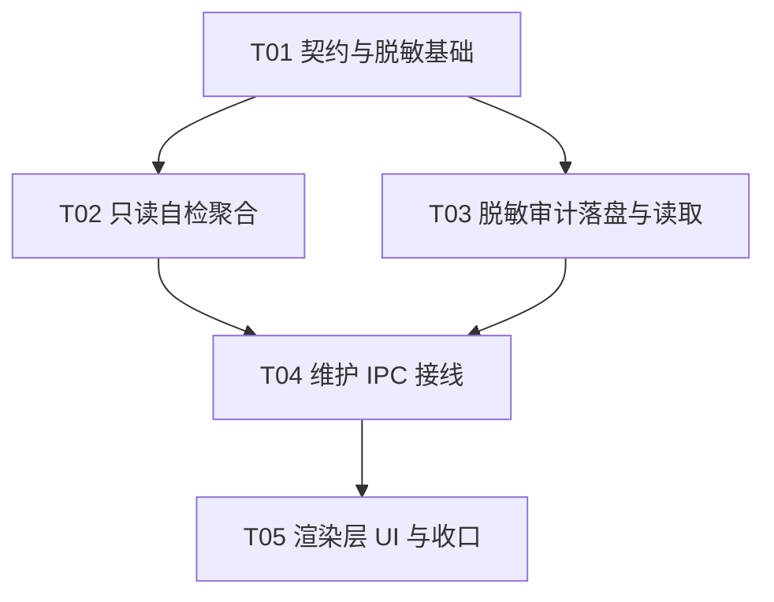

# I6 批次 4 · 自检及管理 UI（进度 / 取消 / 结果 / 只读健康报告与脱敏审计）架构设计

> 范围来源：`docs/INTEGRATION-PLAN-I6.md` 第 4 批逐字 ——
> 「**4. 自检及管理UI：进度/取消/结果/只读健康报告与脱敏审计。**」
> 与固定边界两句绑定：「自检**只读**，日志**不写正文/凭据**」「保留策略 20 份…先预览再用户确认清理」。
>
> 上游裁决：`docs/DECISIONS.md` **D-022**（审计采用数据目录内 JSONL，正文与密钥脱敏）、
> **D-038**（拒绝 Dashboard 健康度/停滞判定——**替用户做科研判断**）、**D-069 邻近**（保留策略审计
> `backup-prune-<日期>.jsonl`：时间/路径/大小/原因/策略快照）、**D-071**（禁止自由文本全局 search-replace）、
> I6 批次 3 §4.2 **S1–S10** 与 §1.3 五条核心纪律。
>
> 本文件是**设计稿**：不改动任何源码、不提交、不碰 git、零新增依赖。
> 目标仓库：`example_demo/Mimir-Desktop`（自有 fork `littleworld215/Mimir-Desktop`；**不触碰上游 `hxhy00/Mimir-Desktop`**）。
> 当前基线：分支 `main`，HEAD `1f598e0`（批次 3 · T05 收口）。

---

## 0. 设计前提与既有资产复用

批次 4 是「在维护窗口里，**只读地回答『我的资料还健康吗』，并把每次写动作留痕成脱敏审计**」。
它与批次 3 的**根本区别**是：批次 3 是**写路径**（解压/发布/注册），批次 4 主体是**只读路径**（自检）
+ 一条**新的、极窄的写路径**（审计落盘 JSONL）。这决定了本批的安全边界比批次 3 更窄、更容易自证。

### 0.1 可直接复用的既有只读原语（已勘察，逐条给行号）

| 既有原语 | 文件:行 | 批次 4 用途 | 只读性 |
|---|---|---|---|
| `readRegistryOverview(home)` | `registryView.ts:13` | 健康报告「空间清单」段 | ✅ 零写（**刻意不复用 `loadStore`**，注释 `:12`） |
| `verifyBackup(path, maxEntries?)` | `verify.ts:63` | 「归档逐条验包」段 | ✅ 只读（fail-fast 抛 `VerifyError`） |
| `canOpenBackup(path)` | `verify.ts:176` | 最轻量「归档可否打开」探测 | ✅ 只读 |
| `checkRestoredAssetsIntegrity(dbPath)` | `assetsIntegrity.ts:85` | 「已发布空间 assets.db 完整性/外键」段 | ✅ `readonly:true`（fail-fast 抛 `RestoreError`） |
| `expectedTableNames(ddl?)` | `assetsIntegrity.ts:52` | schema-drift 检测真源（期望表名） | ✅ 纯函数 |
| `auditStagedSpaceStore(root,…)` | `remapAudit.ts:231` | （批次 3 用）路径审计四桶 | ✅ 只读（唯一 IO） |
| `listRestoreArchives(dir)` | `restoreMain.ts:133` | 「归档候选」段 | ✅ 只读（目录不存在→`[]`） |
| `RESTORE_STAGING_PREFIX` | `restoreContracts.ts:149` | 扫描**残留暂存根**（待清理） | 常量 |
| `deleteAsset(ctx,id)` → `cleanupPending` | `archiveService.ts:81-94` | 孤儿目录/待清理信号来源 | ✅ 只读查询（注释 `:90` 明写「kept for doctor/recovery」） |

### 0.2 勘察得到的三条硬结论（决定了本批的形状）

1. **「自检」是从零新建**：`package.json` 无 `doctor`/`health` 脚本；代码里唯一的 "doctor" 只出现在
   `archiveService.ts:90` 的**注释**（「orphan files are kept for **doctor**/recovery」）。→ 批次 4 新建
   `doctorReport.ts`（纯逻辑）+ handler 接线。
2. **既有「审计」不是 JSONL**：`permissionService.ts:66` 的 `permissions:audit` 落在**空间层 store**（非文件、
   非 JSONL、**无脱敏**）；`D-022` 描述的「数据目录内 JSONL」在本仓库**无现成实现**（`electron/agent/trace.ts`
   已移除）。→ 审计 writer **需新建**，落盘纪律抄 `registryAppend.ts`（原子写 + 0600 + 避开 prune 命名）。
3. **无通用脱敏工具**：全库无 `redact()`；`RestoreFailure.detail` 的注释「**不含**凭据/正文」
   （`restoreContracts.ts:93`）是**既有纪律措辞**，但无统一函数实现。→ 新建 `redact.ts`。

### 0.3 ⚠️ 批次 3 遗留的一处**脱敏真实漏洞**（本批必修）

`restoreMain.ts:305`：

```ts
report('inspecting', `归档内旧空间根：${oldRoot}`)
```

`oldRoot` 是**本机绝对路径**（`manifest.sourceRoot`），却经 `MaintenanceRestoreProgress.detail`
（`workspaceBackupContracts.ts:90`，注释明写「**只含阶段与文案，不含任何本机路径**」）送达渲染层。
这**直接违反本契约自己的注释**。→ 批次 4 **必修**：进度文案一律不含绝对路径（改为只报「已/未取到旧根」）。

---

## 1. 自检（doctor）的只读健康报告

### 1.1 报告模型（**四级严重度 + 逐项结论，绝不汇总成「健康分」**）

对齐 **D-038**（拒绝替用户做科研判断）：报告**只陈述技术事实**，不给「健康度」「评分」「是否该清理」的
结论。每一项都是「检查名 + 结论 + 事实」，用户自己判断。

```ts
/** 单条检查的结论。severity 只描述「技术一致性」的偏离程度，不含任何科研语义。 */
export type DoctorSeverity =
  | 'ok'        // 通过
  | 'notice'    // 可注意（如：发现残留暂存根，可清理但非错误）
  | 'warning'   // 偏离（如：某空间 assets.db 缺表 / 外键违规）
  | 'error'     // 阻塞性（如：注册表不可读 → 无法继续）

export interface DoctorCheck {
  /** 稳定检查 id（SCREAMING_SNAKE，供 UI 与人话映射，不随文案变）。 */
  readonly id: string
  readonly title: string          // 中文短标题
  readonly severity: DoctorSeverity
  /** 面向用户的说明（中文，**不含本机绝对路径**；路径只以 basename/根别名呈现）。 */
  readonly detail: string
  /** 结构化事实计数（可空）。 */
  readonly facts?: Readonly<Record<string, number>>
}

export interface DoctorReport {
  /** 报告生成时刻（ISO）。 */
  readonly at: string
  /** 逐项检查结论（顺序稳定）。 */
  readonly checks: DoctorCheck[]
  /** 汇总计数（便于 UI 概览；**不是**评分）。 */
  readonly summary: { ok: number; notice: number; warning: number; error: number }
}
```

### 1.2 四维检查清单（用户裁决「全量技术自检」）

| # | 检查 id | 内容 | 数据源（只读） | 失败降级为 |
|---|---|---|---|---|
| C1 | `REGISTRY_READABLE` | 注册表 `~/.mimir/store.json` 可读、条目合法、无链接 | `readRegistryOverview` | `error`（无法继续） |
| C2 | `ARCHIVE_VERIFY` | **逐份**归档验包：条目/字节/SHA256/格式版本 | `verifyBackup` 包 try/catch | 单份失败 → 该项 `warning`，其余照列 |
| C3 | `SPACE_INTEGRITY` | **逐空间** `assets.db`：`integrity_check` / 外键 / 期望表齐全 | `checkRestoredAssetsIntegrity` + `expectedTableNames` | 单空间失败 → `warning`，记录空间**名**（非路径） |
| C4 | `RESIDUAL_ARTIFACTS` | 残留**暂存根**（`RESTORE_STAGING_PREFIX`）与**待清理**信号 | 目录扫描 + `cleanupPending` 信号 | 发现 → `notice`（可清理，非错误） |

**只读性保证（本批的红线）**：

- C1–C4 **全部只读**，**不取任何锁、不建任何目录、不写任何文件**。
- C2 的 `verifyBackup`、C3 的 `checkRestoredAssetsIntegrity` 都是 **fail-fast 抛错式**——
  设计**不改它们的抛错语义**（那是批次 2/3 的既定契约，改了会波及既有测试）；doctor 在**调用侧**
  包 `try/catch`，把 `VerifyError.code` / `RestoreErrorCode` **映射为报告条目**（`warning`）。
- C3 打开 `assets.db` **必须 `readonly:true`**（对齐 `assetsIntegrity.ts:9-14` 的实测说明：源库 WAL）。

### 1.3 严重度判定（无「评分」，只有事实）

```
C1 error  → summary.error = 1，其余维仍然尽力跑（不让一个失败吞掉全报告），
            但报告顶部明确「注册表不可读，空间相关检查已跳过」。
C2/C3 单份失败 → warning，逐条列出「哪一份/哪个空间 + 错误码」。
C4 发现残留     → notice，列出「发现 N 个残留暂存根（不自动清理，可在下一步手动确认）」。
全 ok          → 全 `ok`；**允许全绿就是全绿**（对齐批次 3 §3.5「零处需重写不算失败」的同款纪律）。
```

> **明确不做**：不做「一键修复」、不做「自动清理残留」、不做「健康评分」。
> 自检**只读**是固定边界的明文（「自检只读」）；任何「修复」都必须是**另一个显式动作**，
> 且**不在本批**（本批只报告）。

---

## 2. 脱敏审计（**新建 JSONL writer + 脱敏函数**）

### 2.1 落盘契约（对齐 D-022 / D-069 邻近范式）

- **落点**：`~/.mimir/logs/maintenance-audit-<YYYY-MM-DD>.jsonl`（**按天分片**，与 D-069 的
  `backup-prune-<日期>.jsonl` 同构；`logs/` 目录**只在首次写入时** `mkdirSync(recursive)`）。
- **格式**：JSONL（每行一个 JSON 对象，UTF-8，`\n` 结尾）。
- **落盘纪律**（抄 `registryAppend.ts`）：
  - **S-A1 原子追加**：不整文件重写——`appendFileSync` 单行追加（O_APPEND 语义，崩溃只丢半行，
    下一行起仍可解析；**不**用 temp+rename：审计是**追加流**，rename 会丢并发窗口）。
  - **S-A2 权限 0600**：`openSync(path, 'a', 0o600)`；win32 跳过 chmod（对齐 `tightenFileMode`）。
  - **S-A3 失败仅告警**：审计落盘失败 `console.warn` 后继续，**绝不影响**被审计的维护动作本身
    （对齐 `permissionService.recordAudit` 的尽力而为语义）。
  - **S-A4 绝不记录正文/凭据**：见 §2.2。

### 2.2 脱敏清单（**哪些字段必须被替换/剔除**）

审计 writer **只接受白名单形状的 entry**，**不接受任意对象**——从类型上就杜绝「顺手塞进整条记录」。

```ts
/** 允许落审计的条目形状（白名单字段，无自由挂载位）。 */
export interface MaintenanceAuditEntry {
  readonly at: string                    // ISO
  readonly action: 'restore' | 'doctor'  // 本批两类动作
  readonly outcome: 'ok' | 'failed'
  readonly code?: string                 // 失败码（SCREAMING_SNAKE，非自由文本）
  /** 计数类事实（条目数/字节/改写数/检查项数…）。 */
  readonly counts?: Readonly<Record<string, number>>
  /** 脱敏后的**标识**：空间**名**、归档**文件名（basename）**；**绝不含绝对路径**。 */
  readonly labels?: Readonly<Record<string, string>>
}
```

**必须脱敏的字段（若出现于任何待记录数据）**：

| 类别 | 处理 | 例 |
|---|---|---|
| 本机绝对路径 | 只留 **basename**，或整段替换为根别名（`<space-root>`/`<home>`） | `D:\科研\我的空间\papers\a.pdf` → `a.pdf` |
| 密钥/凭据键名 | **整体剔除**（键名命中 `token`/`key`/`secret`/`password`/`credential`/`authorization`） | `{ apiKey: '…' }` → 键消失 |
| 正文类 | **绝不记录**（本 writer 的 entry 形状里根本没有字段可放正文） | — |
| 自由文本 | **绝不记录**（`code` 限定为 SCREAMING_SNAKE 枚举，`labels` 值限 basename） | — |

```ts
/** 通用脱敏：递归替换绝对路径样字符串为 basename；剔除敏感键名。纯函数，供单测。 */
export function redactValue(value: unknown): unknown
/** 把一段字符串里的绝对路径样片段替换为基名（用于 detail 类文案）。 */
export function redactText(text: string): string
```

### 2.3 审计的**触发点**（哪些动作留痕）

| 触发点 | action | 时机 | 是否影响主流程 |
|---|---|---|---|
| 恢复成功 / 失败 | `restore` | `runMaintenanceRestore` 返回后（handler 侧） | **否**（尽力而为，失败仅 warn） |
| 自检完成 | `doctor` | `buildDoctorReport` 返回后（handler 侧） | **否** |
| 恢复的**路径改写明细** | `restore` 的 `counts.rewritten` | 只记**计数**（不上 `oldValue`/`newValue` 绝对路径） | **否** |

> **明确不做**：不落 `RemapAuditReport` 的 `found[]`/`skipped[]`/`observed[]` 的**逐条绝对值**
> （它们含本机绝对路径）。若 UI 要展示「改写了哪几条」，只展示**脱敏后**的 `{ storeKey, locator, field }`
> （**不含 value**）——`locator` 是 arxivId / 下标，非路径，可安全展示。

---

## 3. 维护窗口 UI（进度 / 结果 / 自检 / 审计）

### 3.1 新增区块（在既有 `maintenance.tsx` 内追加，**不改既有结构**）

| 区块 | 位置 | 内容 |
|---|---|---|
| **自检面板** | 「归档候选」之下 | 「运行自检」按钮 → 只读报告表格（检查名 / 结论色块 / 事实）；severity 用**文字标签**（通过/可注意/偏离/阻塞），**不用**分数或环形图（避免「健康度」暗示，对齐 D-038） |
| **进度增强** | 恢复对话框内 | 用上 `progress.stage`（阶段名映射为「正在校验 / 正在解压…」），并区分自检进度（`doctorProgress`） |
| **审计查看** | 页面底部 | 「最近维护审计」列表（读 JSONL 最近 N 条，**已脱敏**）；只读，无删除按钮 |

### 3.2 取消的**真实边界**（用户裁决「进度增强 + 自检进度」）

固定边界未要求「可取消恢复」，但要求「进度/取消/结果」三件事在 UI 上可见。本批的**诚实做法**：

- **自检**：可取消（只读，无副作用；取消 = 停止继续跑剩余检查项）。→ 加 `doctorCancel` 通道。
- **恢复**：**在 `publishing`/`registering` 阶段不可取消**（取消会产生半成品/未注册目录，违反 §1.3）。
  实现为：**取消按钮在这些阶段置灰**，并显示「已进入发布阶段，无法安全取消」。
  `inspecting`/`extracting`/`verifying` 阶段**可**取消——取消 = 请求在下一个安全点中止并走
  `cleanupStaging`（本次暂存根）。→ 加 `restoreCancel` 通道。
- **`closeForm` 的 bug 修复**：`maintenance.tsx:71` 现在 `busy` 时直接 `return`——批次 4 改为
  「busy 且处于可取消阶段 → 触发取消；不可取消阶段 → 提示不可取消」。

> ⚠️ 取消与「已发布目录」的竞态：取消信号**只在 `publish` 之前**被接受；`publish` 一旦开始就
> 进入不可取消窗口（与 §1.3「`registering` 失败只重试注册」一致）。竞态处理见 §5 风险表 K5。

---

## 4. 契约与 IPC 扩展（**只追加、可选、向后兼容**）

### 4.1 通道（`shared/workspaceBackupContracts.ts` 的 `WORKSPACE_BACKUP_CHANNELS` 追加）

```ts
doctor:        'workspaceBackup:doctor'          // 只读，invoke
doctorProgress:'workspaceBackup:doctorProgress'  // 事件
doctorCancel:  'workspaceBackup:doctorCancel'    // 只读取消，invoke
restoreCancel: 'workspaceBackup:restoreCancel'   // 恢复取消，invoke
auditRecent:   'workspaceBackup:auditRecent'     // 只读，读 JSONL 最近 N 条
```

**纪律（沿用批次 3）**：

- 这些通道**全部不进** `ipcGate.ts` 的 `control` / `workspaceChanges` 集合（**控制不可嵌套**）。
  自检/审计是**只读**；`restoreCancel` 是**信号**（不写盘、只设标志），都由 `maintenanceMain`
  用**独立** `ipcMain` 注册。
- **同时收口批次 3 的硬编码**：`maintenanceMain.ts:91` 的 `'workspaceBackup:restoreProgress'`
  改为引用 `WORKSPACE_BACKUP_CHANNELS.restoreProgress`（批次 3 只改了 handler，漏了这里）。

### 4.2 `WorkspaceBackupMaintenanceApi` 追加（**全可选**，旧渲染层忽略）

```ts
doctor?(request?: MaintenanceDoctorRequest): Promise<MaintenanceDoctorResult>
onDoctorProgress?(listener: (p: MaintenanceDoctorProgress) => void): () => void
cancelDoctor?(): Promise<MaintenanceCancelResult>
cancelRestore?(): Promise<MaintenanceCancelResult>
auditRecent?(limit?: number): Promise<MaintenanceAuditView>
```

### 4.3 裁剪纪律（**沿用批次 3 `toRestoreResult` 的单向裁剪**）

- `MaintenanceDoctorResult`：成功只出 `{ ok:true, at, checks[], summary }`（`checks[].detail`
  **已脱敏**）；失败只出 `{ ok:false, code, detail }`（**不含**任何本机路径）。
- `MaintenanceAuditView`：只出**已脱敏**条目数组；**不**暴露 JSONL 文件路径本身。
- 新增契约注释**必须**写明「detail/文案不含本机绝对路径」（承接 §0.3 的漏洞教训）。

---

## 5. 任务分解（依赖排序，≤5 任务）

> 硬约束：≤5 任务；每任务 ≥3 个相关文件；T01 为基础设施（契约 + 纯函数 + 挂载）。
> 本批**零新增运行时依赖**（JSONL 用 `node:fs`，脱敏用 `node:path`）。

| Task | 名称 | 源文件（新增/修改） | 依赖 | 优先级 |
|---|---|---|---|---|
| **T01** | 契约与脱敏基础（基础设施） | `shared/workspaceBackupContracts.ts`（追加 5 通道 + doctor/audit/cancel 契约，全可选）、`electron/workspaceBackup/redact.ts`（**新增**：`redactValue`/`redactText`/敏感键名表，纯函数）、`electron/workspaceBackup/doctorReport.ts`（**新增**：`DoctorCheck`/`DoctorReport` 类型 + 严重度判定纯函数骨架）、`test/unit/workspaceBackup/redact.test.ts`（新增） | — | P0 |
| **T02** | 只读自检聚合（数据层） | `electron/workspaceBackup/doctorReport.ts`（修改：`buildDoctorReport(home, deps)` 聚合 C1–C4，fail-fast → 报告条目映射，**全部只读**）、`electron/workspaceBackup/doctorArchiveScan.ts`（**新增**：C2 归档验包包裹）、`electron/workspaceBackup/doctorSpaceScan.ts`（**新增**：C3 逐空间 assets.db 包裹）、`electron/workspaceBackup/doctorResidual.ts`（**新增**：C4 残留暂存根 + 待清理扫描）、`test/unit/workspaceBackup/doctorReport.test.ts`（新增，含「全绿」与「逐项失败降级」双组） | T01 | P0 |
| **T03** | 脱敏审计落盘与读取 | `electron/workspaceBackup/auditWriter.ts`（**新增**：`appendAudit(entry)` → 按天 JSONL、原子追加、0600、失败仅 warn）、`electron/workspaceBackup/auditReader.ts`（**新增**：`readRecentAudit(home, limit)` 只读最近 N 条、行截断容错）、`test/unit/workspaceBackup/auditWriter.test.ts` + `auditReader.test.ts`（新增，含「正文/凭据零落盘」断言） | T01 | P0 |
| **T04** | 维护 IPC 接线（自检/审计/取消） | `electron/workspaceBackup/maintenanceDoctorHandler.ts`（**新增**：`buildDoctorHandler`/`registerDoctorHandler`，纯函数 + 注入，**不 import electron**）、`electron/workspaceBackup/maintenanceMain.ts`（修改：注册 doctor/audit/cancel handler + 进度推送 + 收口 §4.1 硬编码 + 修 §0.3 进度泄漏）、`electron/workspaceBackup/maintenancePreload.cjs`（修改：追加 5 个方法）、`test/unit/workspaceBackup/maintenanceDoctorIpc.test.ts`（新增，假 ipc + 假 trusted 范式） | T02,T03 | P0 |
| **T05** | 渲染层 UI 与收口 | `src/renderer/maintenance.tsx`（修改：自检面板 + 进度增强 + 审计查看 + 取消接线 + 修 `closeForm`）、`src/renderer/maintenance.css`（修改：severity 标签样式）、`test/unit/workspaceBackup/maintenanceUiContract.test.ts`（**新增**：源码契约测试，断言 UI 未引入路径拼接/未引入评分）、`docs/design/I6-BATCH4-DOCTOR-AUDIT.md`（本文件，随实现更新「已落地」标注） | T04 | P0 |

**依赖图**



---

## 6. 测试挂载点

全部挂载在既有 `test/unit/workspaceBackup/`。沿用 `vitest.config.ts` 的 stub 注意事项（§批次 3 §6）。
`maintenanceRestoreIpc.test.ts` 提供「不启动 Electron、假 ipc + 假 trusted」的**直接复用范式**
（`:287-328`：传 `{ handle(ch,cb){captured.cb=cb} }` + `() => true/false`）。

| 挂载文件 | 覆盖内容 | 反假绿要求 |
|---|---|---|
| `redact.test.ts`（新） | 绝对路径 → basename；敏感键名剔除；正文原样不落；嵌套对象/数组递归；URL 不被误伤 | **必须含「凭据键值不出现在输出」断言** + 变异验证（临时移除键名表 → 变红） |
| `doctorReport.test.ts`（新） | C1–C4 聚合；单份归档失败 → 其它照列；单空间缺表 → warning 且**记录空间名非路径**；全绿 = 全 ok | **双组**：全绿组 + 逐项降级组；断言 detail **不含绝对路径** |
| `auditWriter.test.ts`（新） | 按天分片命名；追加不覆盖；0600（win32 跳过）；写失败仅 warn 不抛；**正文/凭据字段零落盘** | 读回落盘文件逐字断言「无 `D:\`/`/home/`/疑似 key」 |
| `auditReader.test.ts`（新） | 读最近 N 条；半行截断容错；文件不存在 → `[]`；超限行截断 | 失败组：写坏的半行 JSON 不被解析成功 |
| `maintenanceDoctorIpc.test.ts`（新） | 规范化；只读端到端；非信 sender → `UNAUTHORIZED_SENDER`；结果**单向裁剪**（不泄漏路径）；取消信号语义 | 断言 `toDoctorResult` **不含** home / 暂存根路径 |
| `maintenanceUiContract.test.ts`（新） | 源码契约：`maintenance.tsx` 不含 `path.join`/`\\` 拼接；不含评分/百分比字样；取消在 `publishing`/`registering` 阶段被禁用 | 字符串断言 + 反例（注入一行评分文案 → 变红由人工评审） |

**沙箱内必然失败/跳过**（沿用批次 3 §4.3）：`localDisk.test.ts` 全程、任何真实 `~/.mimir` 写入
（doctor/audit 测试一律用 `mkdtemp` 合成 home）、真实 Electron 窗口端到端。

---

## 7. 风险表

| # | 风险 | 等级 | 触发条件 | 缓解 |
|---|---|---|---|---|
| K1 | **自检变成「科研健康度」** | **高** | 误加评分/停滞判定/建议 | 对齐 **D-038**；报告只有技术事实；`maintenanceUiContract.test.ts` 断言无评分字样 |
| K2 | **审计泄漏本机路径/凭据** | **高** | 直接落 `RemapAuditReport` 的绝对值 | entry **白名单形状**（类型上无自由字段）+ `redact.ts` + 落盘读回断言 |
| K3 | **自检偷偷写盘** | **高** | 复用 `loadStore()`/自动建目录 | 只用 §0.1 的**只读**原语；`readRegistryOverview` 注释即「不 loadStore」；单测断言「无新文件」 |
| K4 | **`verifyBackup` 抛错吞掉整报告** | 中 | fail-fast 未包 try/catch | doctor **在调用侧**包裹；单份失败只降为该项 `warning` |
| K5 | **取消与发布竞态 → 半成品** | 中 | 取消到达时 `publish` 已开始 | 取消**只在 `publish` 前**被接受；`publishing`/`registering` 阶段置灰；§1.3 语义不变 |
| K6 | **审计写失败拖垮维护动作** | 中 | 磁盘满/权限错 | S-A3：失败仅 `console.warn`，绝不上抛 |
| K7 | **进度/结果泄漏绝对路径**（批次 3 已存在） | 中 | `report('inspecting', 旧空间根:${oldRoot})` | 本批修正（§0.3）；契约注释重申；单测断言 |
| K8 | **JSONL 半行截断致解析失败** | 低 | 崩溃在写行中途 | reader 逐行 try/catch，坏行跳过并计数 |
| K9 | **新增通道被误加进 gate 集合** | 中 | 照抄时放进 `workspaceChanges` | §4.1 红线 + `ipcGate.test.ts` 断言集合不含新通道 |
| K10 | **`assets.db` 非只读打开** | 中 | 忘传 `readonly:true`（WAL 下会建 `-wal`/`-shm`） | 复用 `checkRestoredAssetsIntegrity`（已 `readonly:true`）；单测断言无 `-wal` 产生 |

---

## 8. 未决项与假设

| # | 事项 | 结论 |
|---|---|---|
| U1 | 自检是否需要支持「仅扫某个空间」 | **假设不需要**：全量自检（用户裁决）。逐个空间深扫已含在全量里。 |
| U2 | 审计保留份数 | **假设不做 prune**（本批只追加，不做清理）；保留策略是**批次 5** 的范围。 |
| U3 | `logs/` 目录是否需 `.gitignore` | `~/.mimir/logs/` 在**用户 home**（非仓库），无需；若发现落在仓库内须补。 |
| U4 | 自检进度是否需要百分比 | **假设不需**：只报「正在检查 X（第 i/n 项）」，避免百分比暗示「接近完成」的假象。 |
| U5 | 取消恢复是否需要新状态 | **假设不需要**：取消 = 在安全点中止 + `cleanupStaging`，复用 `failed` 终态（`code: 'CANCELLED'`）。 |
| U6 | 真实 `assets.db` 在 vitest node ABI 下能否 `integrity_check` | **开放**：批次 3 已用 node ABI binding 测过 `assetsIntegrity`；真实 Electron ABI 留真实 Windows 验收。 |
