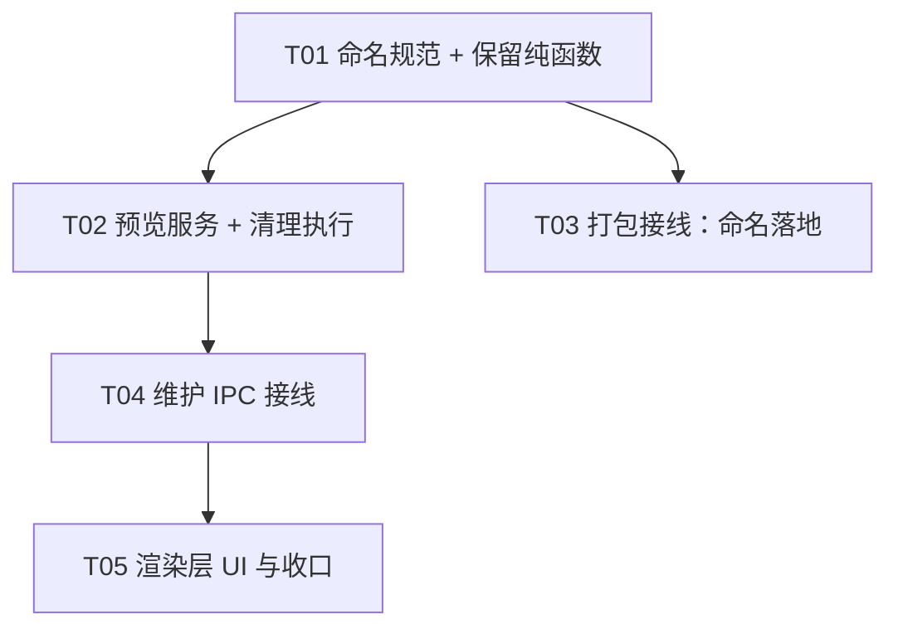

# I6 批次 5 · 保留策略（归档命名规范 + 20 份预览/确认 + 不可变快照保护）架构设计

> 范围来源：`docs/INTEGRATION-PLAN-I6.md` 第 5 批逐字 ——
> 「**5. 保留策略：20份候选预览/确认，保护不可变快照。**」
> 与固定边界两句绑定：「**默认普通备份保留 20 份，先预览再用户确认清理；保护迁移/注册前/导入包**」。
>
> 上游裁决：`docs/DECISIONS.md` **D-032**（自动备份的受控保留例外——**本批的直接范本**）、
> **D-033**（快照文件名刻意不匹配 prune 模式）、**D-004/D-085**（迁移前自动备份只增不改）、
> I6 批次 3 §4.2 **S1–S10**、批次 4 §2.1 审计 JSONL 范式。
>
> 本文件是**设计稿**：不改动任何源码、不提交、不碰 git、零新增依赖。
> 目标仓库：`example_demo/Mimir-Desktop`（自有 fork；**不触碰上游 `hxhy00/Mimir-Desktop`**）。
> 当前基线：分支 `main`，HEAD `f62a7bf`（批次 4 收口）。

---

## 0. 设计前提与勘察结论（**决定本批形状的三条硬事实**）

### 0.1 归档命名规则**当前不存在**（用户裁决：先标准化）

勘察结论：
- `packer.createBackup(request)` 的 `destination` 由**调用方**给出（`packer.ts:35`），packer **不定义**
  文件命名规则，只保证「目标必须不存在（`TARGET_EXISTS`）+ 同盘原子 rename 发布」（`packer.ts:82/140`）。
- **生产代码里 `createBackup` 没有任何调用点**——只在测试中调用（`test/unit/workspaceBackup/`）。
  上游计划文档亦持续记载「普通 main 完整锁/闸门未装配」「第二至六批未实现」。
- 归档目录 = `join(home, 'backups')`（`maintenanceMain.ts:20`），列表按 `.zip` 后缀过滤
  （`restoreMain.ts:138`）。

**→ 结论**：保留策略的白名单必须锚定「文件名规律」，而该规律尚不存在。故 **T01 必须先把归档
命名规范定义出来**（一个纯函数 `deriveArchiveName`），作为保留策略白名单的**唯一事实源**。
命名规范的接线（谁在打包时调用它）**属本批范围**，但**打包→IPC 的完整接线仍留后续**（见 §5 T01 说明）。

### 0.2 I6 里**另有两类不可变快照**（用户裁决：全保护，不清理）

| 产物 | 位置 | 命名 | 生产者 | 本批处置 |
|---|---|---|---|---|
| 空间内**迁移前**快照 | `<space>/…/backups/` 下（`backupsDir` 由调用方给） | `schema-<version>-<ts>-<uuid>.db` | `migrations.ts:52` `snapshotBeforeMigration` | **绝不触碰** |
| 本机**注册前**快照 | `~/.mimir/` | `store.json.pre-restore-<ISO>-<短uuid>.bak` | `registryAppend.ts:38` `REGISTRY_SNAPSHOT_PREFIX` | **绝不触碰** |
| 恢复暂存根 | `<parent>/.mimir-restore-staging-<uuid>/` | `RESTORE_STAGING_PREFIX` | 批次 3 | **绝不触碰**（批次 4 已作 notice 上报） |

**→ 结论**：本批**只清理 `backups/` 下的整空间归档**。上表三类一律进「绝不触碰清单」，
并在实现里以**显式断言**（而非「恰好没匹配」）保证不被误删——对齐 D-032 决策 5 的「绝不触碰」条目。

### 0.3 D-032 的**可移植原则**（逐条）

D-032 是旧架构（`data/app.db.bak-*`）的保留例外，但其**设计原则可逐条移植**：

| D-032 原则 | 移植到 I6 批次 5 |
|---|---|
| 默认不可变，只有**显式触发**才清理 | ✅ 铁律：无定时任务、无启动清理 |
| dry-run 默认只报告 | ✅ 维护窗口「预览」= dry-run |
| 严格白名单（文件名正则） | ✅ 改为归档新命名规范的正则（§1.1） |
| 保命下限：最新 N 份 | ✅ N = **20**（固定边界明文） |
| 绝不触碰清单 | ✅ 按 §0.2 重写 |
| 多重护栏 | ✅ 路径在 `backups/` 内、拒符号链接、拒非本应用产物 |
| 可审计 JSONL | ✅ **复用批次 4 刚建的 `auditWriter`** |
| **不引入自动后台清理** | ✅ 明文继承 |

---

## 1. 归档命名规范与保留策略

### 1.1 归档命名规范（**T01 新增，唯一事实源**）

```ts
/** 归档文件名：`mimir-backup-<空间名slug>-<YYYYMMDD-HHMMSS>.zip`。 */
export const ARCHIVE_FILE_PATTERN = /^mimir-backup-([a-z0-9-]{1,64})-(\d{8}-\d{6})\.zip$/

/** 由空间名 + 时钟生成归档文件名（纯函数，供打包接线使用）。 */
export function deriveArchiveName(spaceName: string, at: Date): string
/** 判定一个文件名是否是本应用产出的归档（保留策略白名单的**唯一**入口）。 */
export function isManagedArchive(fileName: string): boolean
/** 从归档名解析出时间戳（供保留策略排序；解析失败 → null）。 */
export function archiveTimestamp(fileName: string): Date | null
```

**规则细节**：
- slug 化：空间名 → 小写、非 `[a-z0-9]` 折为 `-`、压缩连续 `-`、裁到 64 字符；**slug 为空时**
  用 `space`（保证正则恒可匹配，不留「无 slug」的歧义形态）。
- 时间戳用**本地时间** `YYYYMMDD-HHMMSS`（与 D-032 的 `\d{8}-\d{6}` 同构，人可读）。
- **为什么不用 UUID 名**（批次 2 暂存名 `backup-<uuid>.zip.partial` 用了 UUID）：保留策略需要
  **可解析的时间+可识别的空间**来做「按时间保留 20 份」与用户可读的预览；UUID 两者都给不了。
  `.partial` 是**暂存名**（打包中），发布名才是上面的最终名 → 保留策略**绝不匹配 `.partial`**。

### 1.2 保留策略（**纯函数，可单测**）

```ts
export interface RetentionPolicy {
  /** 保留最新份数（**固定 20**，固定边界明文）。 */
  readonly keep: number
  /** 保护窗口：N 天内一律保留（可选加固；默认 0 = 不启用）。 */
  readonly keepDays?: number
}

export interface RetentionCandidate {
  readonly path: string        // 绝对路径（**仅服务层用**，不进 UI）
  readonly name: string
  readonly bytes: number
  readonly modifiedAt: string
}

export interface RetentionPlan {
  /** 保留项（含原因：`recent` / `within-days`）。 */
  readonly keep: Array<RetentionCandidate & { reason: 'recent' | 'within-days' }>
  /** 清理候选（**最早**先删；附原因）。 */
  readonly candidates: Array<RetentionCandidate & { reason: 'beyond-keep' }>
  /** 可释放字节合计。 */
  readonly reclaimableBytes: number
}

/** 纯函数：按策略把归档分成「保留」与「清理候选」，**绝不删除任何东西**。 */
export function planRetention(archives: readonly RetentionCandidate[], policy: RetentionPolicy): RetentionPlan
```

**规则**：
- 排序按 `modifiedAt` **降序**（最新在前）；前 `keep` 份 → `recent` 保留。
- `keepDays > 0` 时，`now - modifiedAt <= keepDays` 的也保留（`within-days`）。
- 其余 → `candidates`（**只报告，不删**）。
- **只接受已通过 `isManagedArchive` 白名单的名字**：非白名单文件**永不**进 `planRetention` 的输入
  （上游过滤，见 §1.3）。→ 这从类型/调用两侧保证「绝不触碰」。
- **零删除**：`planRetention` 是纯函数；真正的删除是**另一个显式动作**（§2）。

### 1.3 输入过滤（**绝不触碰的实现保证**）

```ts
/** 只读扫描 backups/，**只**返回本应用产出的归档（白名单过滤在本函数内）。 */
export function listManagedArchives(backupsDir: string): RetentionCandidate[]
```

- 目录不存在 → `[]`（只读，不建目录）。
- 只收 `isManagedArchive(name) === true` 的**普通文件**（`withFileTypes` + `isFile()`）。
- **显式排除**（三重断言，而非「恰好没匹配」）：
  1. `name.endsWith('.partial')` → 跳过（打包中）；
  2. `name.startsWith(REGISTRY_SNAPSHOT_PREFIX)` 或含 `pre-restore` → 跳过；
  3. `isSymbolicLink()` → 跳过（对齐 D-032「拒绝符号链接」护栏）。

---

## 2. 预览与确认（两步，**无后台自动清理**）

### 2.1 预览（dry-run，只读）

- IPC：`workspaceBackup:retentionPreview`（**只读**）→ 返回 `RetentionPlan` 的**脱敏视图**。
- 视图**只含**：归档**文件名**、大小、修改时间、保留/清理标记、可释放字节合计。
  **绝不含**绝对路径（对齐批次 4 §4.3 裁剪纪律；路径由主进程内部持有）。
- **不取锁、不建目录、不写文件**。

### 2.2 确认清理（显式、单次、可审计）

- IPC：`workspaceBackup:retentionApply`（**写路径**），入参**只有一个**：`{ confirmToken: string }`。
  - `confirmToken` 由**预览**返回（服务层生成的一次性 token，绑定「本次预览的候选集合」）。
  - **为什么用 token 而非回传文件列表**：回传列表 = 信任渲染层拼的路径（违反批次 3 §4.2 S7）。
    token 让主进程**自己**重算候选，渲染层无法指定删除哪个文件。
- 执行流程（**严格顺序**，对齐 D-032 与批次 3 §1.3 纪律）：
  ```
  ① trusted(event) 校验（维护窗口主框架）
  ② 重算 listManagedArchives + planRetention（**不信渲染层**）
  ③ 校验 confirmToken 与「本次候选集摘要」匹配（防过期/防替换）；不匹配 → TOKEN_MISMATCH，零副作用
  ④ 逐条删除（**先删最早**），每条删前**再**复核 isManagedArchive + isFile + 非符号链接
  ⑤ 删除失败 → 该条记 failed，**继续**其余（不整批中止），最终如实报告
  ⑥ 写审计 JSONL（复用批次 4 auditWriter：action='retention', counts={removed, kept, failed}）
  ```
- **失败语义**：删除是**幂等**的（文件已不存在 → 视为已达成，记 ok 不报错）。
  **不**承诺「全成功」；每条结果如实上报（对齐 D-032 验收「审计条目数等于删除数」）。

### 2.3 ⚠️ 明确不做

- **不引入定时任务 / 启动时清理**（D-032 决策后果明文：「**不**引入任何自动后台清理」）。
- **不做「清空全部」/「清到只剩 N 份」的一键操作**——只按策略预览 + 确认，用户可见每条候选。
- **不清理** `schema-*.db` / `store.json.pre-restore-*` / 暂存根 / `.partial`。

---

## 3. 契约与 IPC 扩展（只追加、可选、向后兼容）

### 3.1 通道（`WORKSPACE_BACKUP_CHANNELS` 追加）

```ts
retentionPreview: 'workspaceBackup:retentionPreview',  // 只读，invoke
retentionApply:   'workspaceBackup:retentionApply'     // 写，invoke（带 confirmToken）
```

**纪律（沿用批次 3/4）**：两通道**均不进** `ipcGate.ts` 的 `control` / `workspaceChanges` 集合
（**控制不可嵌套**）；由 `maintenanceMain` 用**独立** `ipcMain` 注册。

### 3.2 类型

```ts
export interface MaintenanceRetentionItem {
  readonly name: string           // 文件名（basename，**非绝对路径**）
  readonly bytes: number
  readonly modifiedAt: string
  readonly disposition: 'keep' | 'remove'
  readonly reason: string         // 'recent' | 'within-days' | 'beyond-keep'
}
export type MaintenanceRetentionPreview =
  | { ok: true; items: MaintenanceRetentionItem[]; reclaimableBytes: number; confirmToken: string; keepPolicy: number }
  | { ok: false; code: string; detail: string }
export type MaintenanceRetentionResult =
  | { ok: true; removed: number; failed: number; reclaimedBytes: number }
  | { ok: false; code: string; detail: string }
```

`WorkspaceBackupMaintenanceApi` 追加（**全可选**）：`retentionPreview?()` / `applyRetention?(token)`。

---

## 4. 维护窗口 UI

在既有 `maintenance.tsx` 追加一个「**备份保留**」区块（放在自检面板**之下**）：
- 「预览保留情况」按钮 → 只读列表（文件名 / 大小 / 时间 / 保留 or 清理标记）+ 「可释放 N MB」。
- 「确认清理 M 份」按钮（**仅当有清理候选时启用**）→ 二次确认（`confirm()` 或行内确认条）→ 调 `applyRetention(confirmToken)`。
- 结果如实展示（`removed`/`failed`/`reclaimedBytes`）；**失败条目单列**，不掩盖。
- **不得**出现「一键清理」「自动清理」等暗示后台行为的文案（D-032 铁律）。

---

## 5. 任务分解（依赖排序，≤5 任务）

> 硬约束：≤5 任务；每任务 ≥3 个相关文件；T01 为基础设施（命名规范 + 纯函数 + 契约）。

| Task | 名称 | 源文件（新增/修改） | 依赖 | 优先级 |
|---|---|---|---|---|
| **T01** | 归档命名规范 + 保留纯函数（基础设施） | `electron/workspaceBackup/archiveNaming.ts`（**新增**：`ARCHIVE_FILE_PATTERN`/`deriveArchiveName`/`isManagedArchive`/`archiveTimestamp`）、`electron/workspaceBackup/retentionPolicy.ts`（**新增**：`planRetention` 纯函数）、`electron/workspaceBackup/archiveScan.ts`（**新增**：`listManagedArchives` 只读扫描 + 三重排除）、`shared/workspaceBackupContracts.ts`（追加 2 通道 + retention 类型）、`test/unit/workspaceBackup/archiveNaming.test.ts` + `retentionPolicy.test.ts`（新增） | — | P0 |
| **T02** | 预览服务层 + 清理执行（数据层） | `electron/workspaceBackup/retentionService.ts`（**新增**：`buildRetentionPreview`（含一次性 token 生成 + 候选集摘要）、`applyRetention(token, deps)`（重算 + token 校验 + 逐条删除 + 幂等 + 审计））、`electron/workspaceBackup/retentionToken.ts`（**新增**：token 生成/校验纯函数，绑定候选集摘要）、`test/unit/workspaceBackup/retentionService.test.ts`（新增，含「token 不匹配零副作用」「绝不触碰三类快照」「幂等」） | T01 | P0 |
| **T03** | 打包接线：归档命名落地 | `electron/workspaceBackup/packer.ts`（**修改**：`BackupRequest` 增可选 `spaceName`，内部用 `deriveArchiveName` 生成 destination 的建议名——**或**保持 destination 由调用方给，仅导出命名函数供后续接线；见下方说明）、`electron/workspaceBackup/archiveNaming.ts`（可能微调）、`test/unit/workspaceBackup/packerVerify.test.ts`（修改：补存档名规范用例） | T01 | P1 |
| **T04** | 维护 IPC 接线（预览/清理） | `electron/workspaceBackup/maintenanceRetentionHandler.ts`（**新增**：`buildRetentionHandler`/`registerRetentionHandler`，纯函数 + 注入，**不 import electron**）、`electron/workspaceBackup/maintenanceMain.ts`（修改：注册两通道）、`electron/workspaceBackup/maintenancePreload.cjs`（修改：追加 2 方法）、`test/unit/workspaceBackup/maintenanceRetentionIpc.test.ts`（新增，假 ipc + 假 trusted 范式） | T02 | P0 |
| **T05** | 渲染层 UI 与收口 | `src/renderer/maintenance.tsx`（修改：保留区块 + 二次确认）、`src/renderer/maintenance.css`（修改：保留/清理标记样式）、`test/unit/workspaceBackup/maintenanceUiContract.test.ts`（修改：追加「无自动清理暗示文案」断言）、`docs/design/I6-BATCH5-RETENTION.md`（本文件） | T04 | P0 |

**依赖图**



> **T03 的范围裁量（team-lead 说明）**：`createBackup` 的生产接线（谁触发打包 / IPC 通道）**超出本批**——
> 本批只需让**命名规则成为唯一事实源**并可用（`deriveArchiveName` 导出 + 单测锁定其与
> `ARCHIVE_FILE_PATTERN` 互逆）。若 worker 发现「不改 packer 也能让保留策略自洽」，则 T03 收缩为
> 「命名函数 + 契约测试」，**不强行造一个假的打包接线**。

---

## 6. 测试挂载点

| 挂载文件 | 覆盖内容 | 反假绿要求 |
|---|---|---|
| `archiveNaming.test.ts`（新） | slug 化边界（空名/中文/超长/特殊字符）；`deriveArchiveName` 与 `ARCHIVE_FILE_PATTERN` **互逆**；`isManagedArchive` 对 `.partial`/快照名/UUID 名一律 false | 失败组：`backup-<uuid>.zip.partial` → `false` |
| `retentionPolicy.test.ts`（新） | 21 份 → 保留最新 20、候选 1（最早）；恰好 20 → 零候选；19 → 零候选；`keepDays` 生效；排序正确；**纯函数零副作用**（入参数组未被修改） | 双组：超限组 + 未超限组；断言 `planRetention` 不修改入参 |
| `retentionService.test.ts`（新） | 预览 → token；**token 不匹配 → 零删除**（TOKEN_MISMATCH）；删除**幂等**（重复 apply 第二次 removed=0）；**绝不触碰三类快照**（目录里放 `schema-*.db`/`store.json.pre-restore-*.bak`/`.partial` → 断言全部存活）；审计写入条数 = 删除数 | **必须含「三类快照逐字存活」断言** + 「token 篡改零副作用」 |
| `maintenanceRetentionIpc.test.ts`（新） | 规范化；非信 sender → `UNAUTHORIZED_SENDER`；预览裁剪（**不含绝对路径**）；apply 走 token；结果如实（failed 不掩盖） | 断言预览返回**不含** `D:\`/home 路径 |
| `maintenanceUiContract.test.ts`（改） | 追加：`maintenance.tsx` 不含「自动清理」「一键清理」「定时」等暗示后台行为字样 | 字符串断言，注入违规可变红 |
| `packerVerify.test.ts`（改，T03） | 存档名规范用例 | 视 T03 范围而定 |

**沙箱内必然失败/跳过**（沿用批次 3 §4.3 / 批次 4）：`localDisk.test.ts`；任何真实 `~/.mimir` 写入
（一律 `mkdtemp` 合成 home）。

---

## 7. 风险表

| # | 风险 | 等级 | 触发条件 | 缓解 |
|---|---|---|---|---|
| K1 | **误删不可变快照**（迁移前 / 注册前 / 暂存根） | **高** | 白名单过宽 / 正则误匹配 | `isManagedArchive` 严格正则 + 三重显式排除 + 测试逐字断言存活 + D-032 决策 5 清单 |
| K2 | **渲染层指定删除路径** | **高** | apply 回传文件列表 | 只收 `confirmToken`；主进程**重算**候选（沿用 §4.2 S7） |
| K3 | **过期预览 → 删错** | **高** | 预览后用户又备份了，token 仍有效 | token 绑定**候选集摘要**；不匹配 → `TOKEN_MISMATCH` 零副作用 |
| K4 | **引入后台自动清理** | **高** | 顺手加定时/启动清理 | D-032 明文禁止；UI 契约测试断言无「自动清理」文案；无任何 setInterval/启动钩子 |
| K5 | **删除不可恢复** | 中 | 直接 `unlink` | 本批**不提供回收站**（与 D-032 一致，靠「显式确认 + 白名单 + 审计」三道防线）；文档明确「删除不可撤销」 |
| K6 | **默认保留份数被误改** | 中 | 参数化时写错 | `keep` 常量 = **20**（固定边界）；单测锁定 21→留20 |
| K7 | **符号链接指向外部文件被删** | 中 | 未判链接 | `isFile()` + `!isSymbolicLink()`；`path.resolve` 后在 `backups/` 内 |
| K8 | **审计落盘失败拖垮清理** | 低 | 磁盘满 | 复用批次 4 `auditWriter`（失败仅 warn） |
| K9 | **新增通道被误加进 gate 集合** | 中 | 照抄时放错 | §3.1 红线 + `ipcGate.test.ts` 断言不含新通道 |

---

## 8. 未决项与假设

| # | 事项 | 结论 |
|---|---|---|
| U1 | `keep` 是否可配置 | **假设固定 20**（固定边界明文）；策略参数化保留但默认 20，UI 不暴露调整 |
| U2 | `keepDays` 是否启用 | **假设默认 0（不启用）**；固定边界只要求「20 份」，加天数会与「20 份」语义叠加，故默认关闭、留作加固开关 |
| U3 | 删除是否进回收站 | **假设不进**（与 D-032 一致；靠显式确认 + 白名单 + 审计）。若用户后续要求，属独立增强 |
| U4 | 打包生产接线（谁触发备份） | **本批不做**（超出批次 5 范围）；只在 T03 让命名规则可用。**需在批次 6 或独立批次接线** |
| U5 | `schema-*.db` 迁移前快照的长期累积 | **本批不清理**（用户裁决全保护）；其保留策略留后续（D-085/D-004 的旧语义仍在） |
| U6 | `.mimir/logs/` 审计文件自身的保留 | **本批不做**（批次 4 U2 已记：审计保留属后续） |
